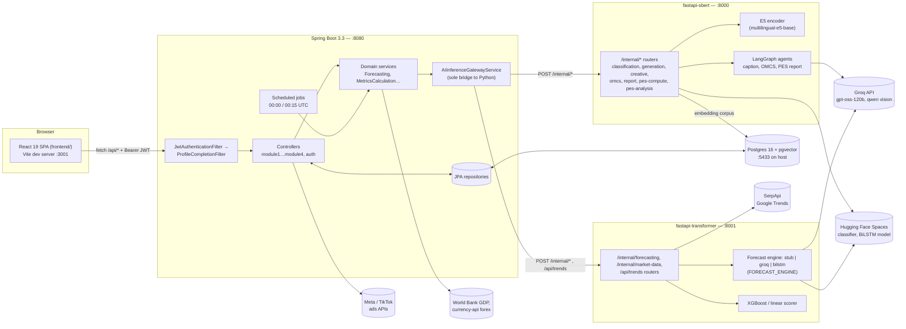
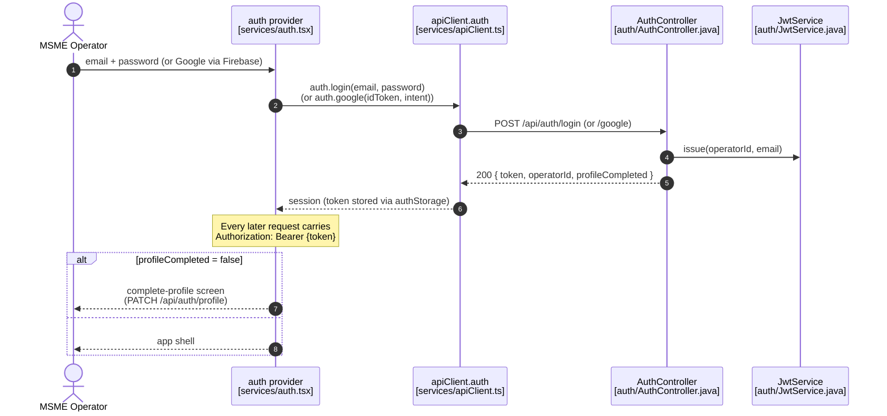
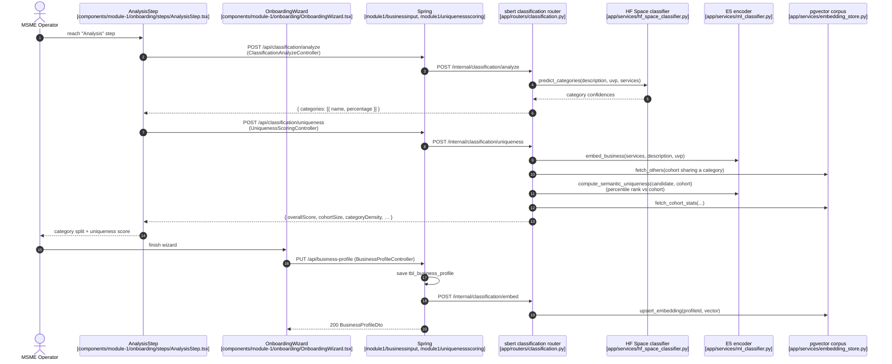
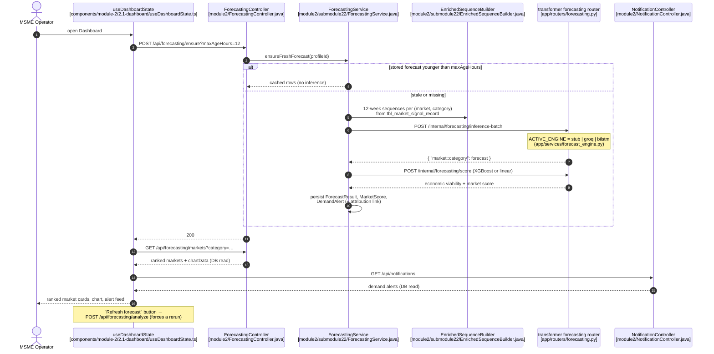
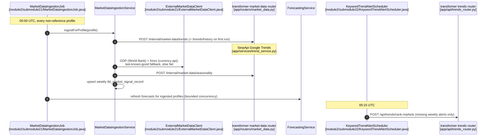
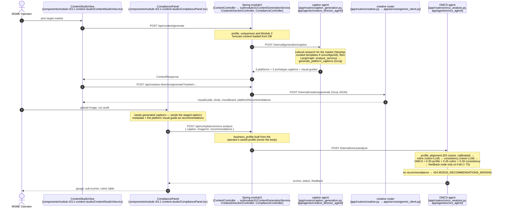
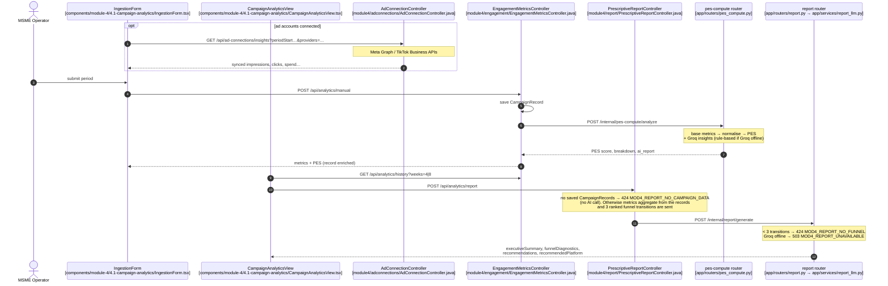
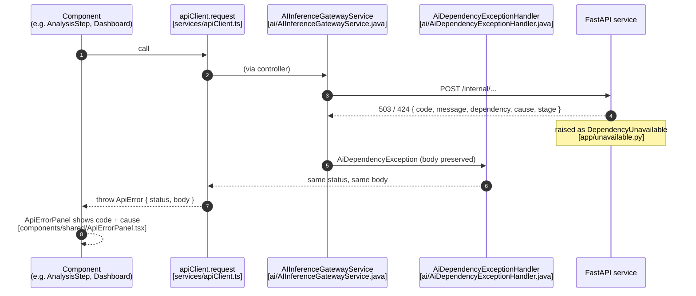

# CeView — Frontend ↔ Backend Sequence Diagrams

How a request travels through CeView today, one diagram per user-facing flow. Every participant
names the real source file, so you can jump straight to it. Paths are relative to `frontend/`,
`backend/spring-boot/src/main/java/com/ceview/`, `backend/fastapi-sbert/` or
`backend/fastapi-transformer/`.

## Social publishing

The October 2026 implementation connects Settings to `module3.social` and persists encrypted publishing grants in `tbl_publishing_account`. Meta shares the Module 4 login; TikTok creator login is separate from TikTok Ads. Public OAuth callbacks only redirect to the SPA. Authenticated completion burns state and binds the exchange to the calling profile.

Content Studio uploads through `module3.media`, then calls `PublishingController` with approved per-platform captions and a tenant-owned ready media ID. `PublishingService` validates the request and writes one durable row per destination. A tenant/request/platform key deduplicates submissions. It claims work in a short transaction and calls the platform outside it; remote identifiers are checkpointed before advancing. The dispatcher uses Postgres `FOR UPDATE SKIP LOCKED` and claims one due row at a time.

Facebook schedules natively. Instagram containers and videos are polled asynchronously; TikTok inbox uploads are confirmed before showing a draft handoff. Meta ads create PAUSED campaign, ad set, media, creative and ad, with a tenant-owned attribution URL from `AdUrlBuilder`. Changing the Page or ad account prevents a partial chain from resuming against a different account. Definite rate limits retry; ambiguous remote writes require operator inspection. Rotating TikTok refresh tokens use a short distributed lease without retaining a database transaction during HTTP.

`module4.postmetrics` reads available post insights daily into `tbl_post_metric`. The shared post view serves Content Studio, Calendar and Performance. Null metrics and daily history gaps remain unavailable. The complete contracts supersede the earlier prototype surfaces below: [backend/CONTRACT.md](backend/CONTRACT.md#social-publishing-endpoints).

Scoring formulas live in [`ARCHITECTURE_SPEC.md`](ARCHITECTURE_SPEC.md); the REST contract in
[`backend/CONTRACT.md`](backend/CONTRACT.md).

---

## 1. System overview

Ground rules that every flow below follows:

- **Every `/api/*` route is JWT-gated** (`config/SecurityConfig.java`, `anyRequest().authenticated()`);
  only `/api/auth/**`, `/actuator/**`, the ad-platform OAuth callbacks and public attribution
  redirects are open. `ProfileCompletionFilter` additionally blocks operators who haven't finished
  their profile.
- **Tenant scoping comes from the token, never the body.** Controllers call
  `auth/CurrentBusinessProfile.resolveProfileId()` (409 if the operator has no profile yet).
- **No synthetic fallbacks.** An AI dependency that can't answer raises `DependencyUnavailable`
  (`fastapi-*/app/unavailable.py`): 503 when a dependency is down, 424 when a required input is
  missing. Spring re-emits the body verbatim (§8).

---

## 2. Sign-in

---

## 3. Module 1 — Onboarding: classify, score uniqueness, save

The onboarding wizard's analysis step calls two endpoints; saving the profile also refreshes the
operator's embedding in the uniqueness corpus.

---

## 4. Module 2 — Dashboard: fresh forecast, ranked markets, alerts

`useDashboardState` makes sure the operator has a recent forecast, then reads ranked markets and
alerts from the database. Inference runs only when the stored forecast is stale.

### 4.1 Daily background jobs (no user action)

---

## 5. Module 3 — Content Studio: captions, creative direction, compliance audit

---

## 6. Module 4 — Campaign analytics: ingest a period, then report

---

## 7. Error path — an AI dependency can't answer

There is no silent mock fallback in the running app. Fixture data is used only when the frontend is
built with `VITE_USE_FIXTURES=true`, and a production build with that flag fails on load.

---

## 8. Features with no backend yet

These screens exist but have no server routes. Spring answers 404 (pinned by
`UnbuiltFeatureRoutesTest`), and the frontend turns that into a plain "isn't available yet" state
(`isNotAvailable` in `services/apiError.ts`) instead of faking success. In fixture mode
(`VITE_USE_FIXTURES=true`) they still run on sample data.

| Feature | Frontend | Behaviour without a backend |
|---|---|---|
| Workspace members and invites | `components/settings/WorkspaceSettings.tsx` | notice shown, invite disabled; "Invite sent" only after the server accepts |
| Social platform connections | `services/connectionsStore.tsx`, `PlatformsSettings.tsx` | notice shown, Connect disabled; Publish modal explains publishing is off |
| Published posts | `ContentStudioView.tsx` | board starts empty (no fixture posts outside fixture mode) |

---

## Quick legend

- **Solid arrow** — synchronous HTTP call awaited by the caller
- **Dashed arrow** — response
- **`alt` / `opt`** — conditional branches
- File paths in `[brackets]` point at the real source for each participant
